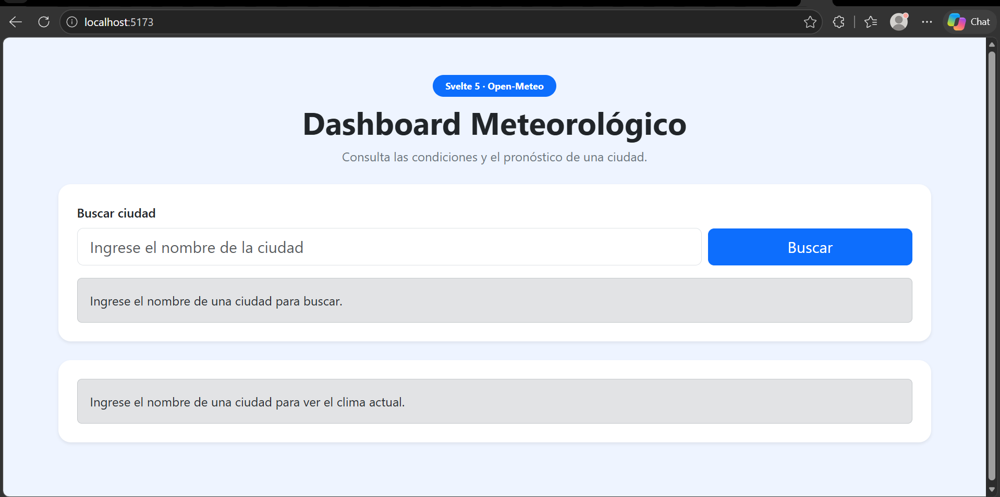
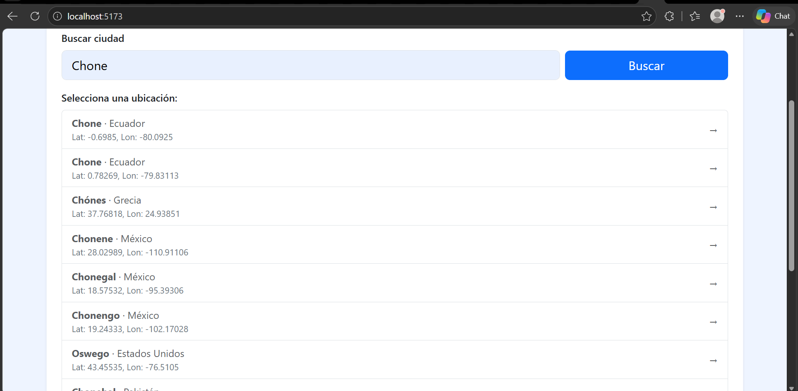
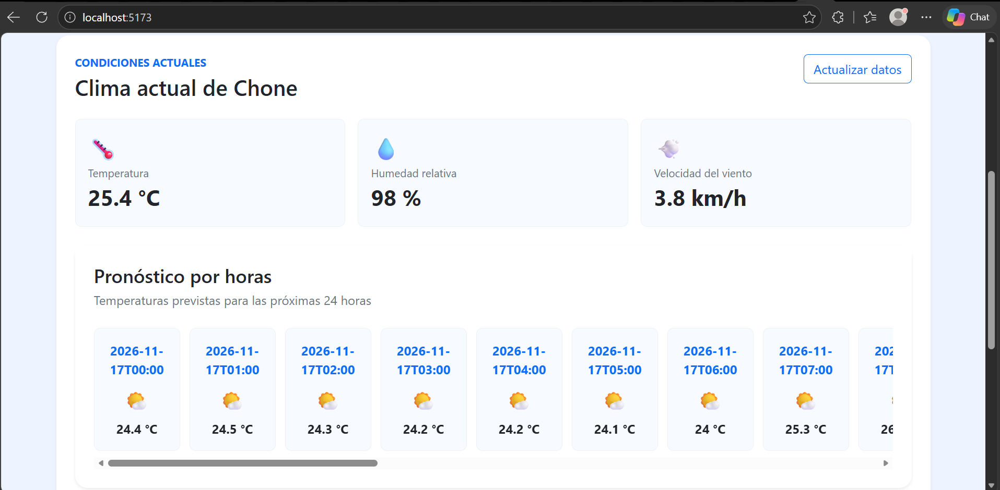
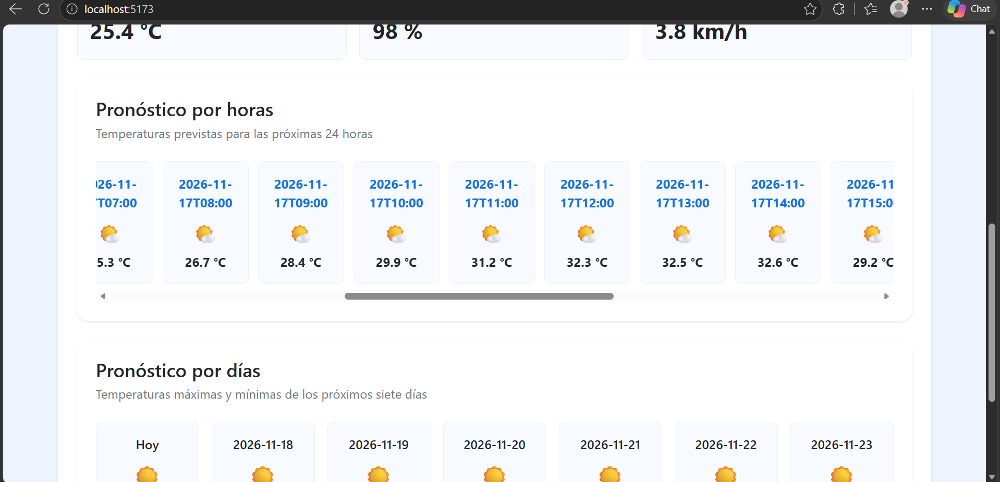
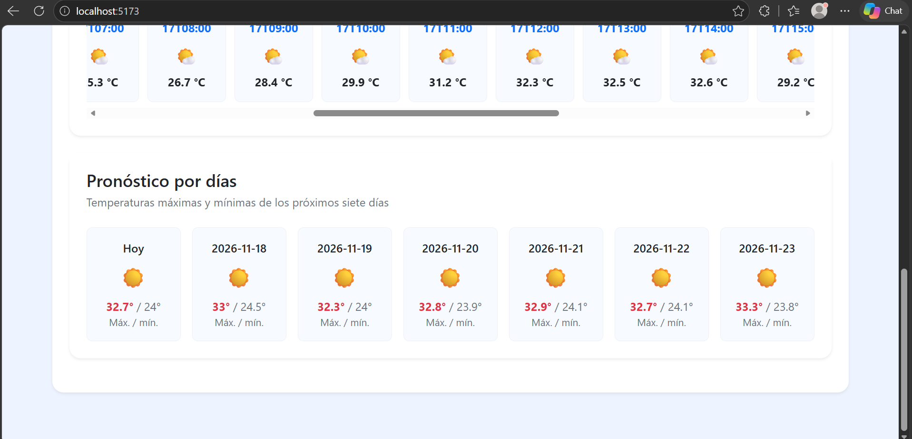

# Dashboard Meteorológico con Svelte 5

Aplicación web que permite buscar una ciudad y consultar su clima actual, pronóstico por horas y pronóstico de siete días mediante la API pública de Open-Meteo.

## Funcionalidades

- Búsqueda de ciudades por nombre.
- Selección de ubicaciones cuando existen varias coincidencias.
- Temperatura actual, humedad relativa y velocidad del viento.
- Pronóstico por horas para las próximas 24 horas.
- Pronóstico diario para los próximos siete días.
- Estados de carga, error y ausencia de resultados.
- Interfaz adaptable con Bootstrap 5 cargado desde CDN.

## Tecnologías

- Svelte 5
- SvelteKit
- Bootstrap 5
- Fetch y async/await
- Open-Meteo REST API

## Requisitos

- Node.js 20 o superior.
- npm.

## Instalación

```bash
npm install
```

## Ejecución

```bash
npm run dev
```

Luego abre la dirección mostrada por Vite, normalmente `http://localhost:5173`.

## Verificación

```bash
npm run check
npm run build
```

## API utilizada

### Geocodificación

```text
https://geocoding-api.open-meteo.com/v1/search
```

### Pronóstico meteorológico

```text
https://api.open-meteo.com/v1/forecast
```

Los servicios utilizados no requieren API Key.

## Organización

```text
src/
├── app.css
├── lib/
│   ├── components/
│   │   ├── App.svelte
│   │   ├── BuscadorDeCiudad.svelte
│   │   ├── ClimaActual.svelte
│   │   ├── PronosticoHoras.svelte
│   │   └── PronosticoDias.svelte
│   └── servicios/
│       └── clima.ts
└── routes/
    ├── +layout.svelte
    └── +page.svelte
```

## Evidencias

### Pantalla inicial



### Búsqueda y selección de ciudad



### Condiciones actuales



### Pronóstico por horas



### Pronóstico de siete días


